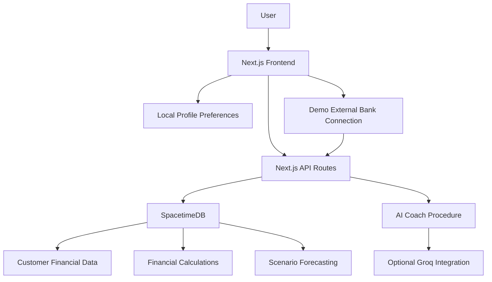

<div align="center">

# PNC 360° 🧭

### Your Money. The Whole Picture.

**See where you've been. Understand where you stand. Explore what's next.**


**[Overview](#-overview)** · **[Features](#-core-features)** · **[Architecture](#-system-architecture)** · **[Getting Started](#-getting-started)** · **[Future Plans](#-future-improvements)**

</div>

---

# ✨ Overview

> **Your financial life isn't made up of separate pieces. Why should your banking experience be?**

Most banking applications present financial information separately: checking accounts, savings, credit cards, loans, investments, and retirement accounts.

While users may have access to all this information, understanding how everything fits together can still be difficult.

**PNC 360°** is an interactive financial health navigator designed to bring these pieces together into one intuitive experience.

Built for **HackUTD 2026's PNC Financial Health Navigator Challenge**, our platform helps users understand their financial lives through three connected perspectives:

| 🕰️ Past | 📍 Present | 🔮 Future |
|---|---|---|
| How did I get here? | Where do I stand? | Where could I go? |
| Understand historical financial activity. | Explore current balances, assets, debts, and obligations. | Simulate financial decisions and future outcomes. |

By combining connected financial information, interactive visualizations, and AI-powered explanations, PNC 360° helps users make sense of their finances without needing to be financial experts.

**Our mission is simple: Make financial understanding accessible to everyone.**

---

# 💡 Why PNC 360°?

Financial information is often fragmented across institutions and account types.

Someone might have:

- Checking and savings at PNC
- A credit card at Chase
- Investments at another institution
- An IRA for retirement
- Student loans or a mortgage
- Upcoming bills and financial commitments

Each account tells part of the story, but none represents the full picture alone.

PNC 360° addresses this by:

- Bringing available financial information into one interface
- Supporting a consolidated view across connected institutions
- Helping users understand their financial position
- Visualizing historical financial activity
- Connecting financial changes with historical resilience
- Making complex financial information easier to interpret
- Allowing users to explore hypothetical future scenarios
- Helping users track short-term and long-term goals
- Providing contextual AI-powered financial explanations

Rather than creating another traditional banking dashboard, we wanted to make financial information **connected, interactive, and understandable**.

---

# 🧩 Core Features

## 1️⃣ Home — 360° Financial Overview

The Home dashboard provides a consolidated view of the user's current financial situation.

### Total Balance

Users can view cash balances across connected financial institutions.

Features include:

- Combined balance across included accounts
- Individual bank balance selection
- Interactive institution tabs
- Support for additional demo bank connections
- Automatic updates to displayed totals when the selected institution changes

The interface allows users to switch between their overall connected cash balance and individual institutions without leaving the dashboard.

### Financial Breakdowns

Explore different parts of your finances through one unified tabbed interface.

Supported categories include:

- Savings
- Credit
- IRA
- Loans
- Investments
- Certificates of Deposit (CDs)

Each category presents relevant financial information without overwhelming the user.

For example:

**Savings**
- Current savings balance
- Savings growth
- Goal progress

**Credit**
- Credit score
- Credit utilization
- Outstanding credit balance
- Available credit

**Loans**
- Remaining balance
- Interest rate
- Principal repaid
- Original loan amount

Users can customize which available financial categories appear.

### 360° Financial Snapshot

An interactive donut visualization compares:

- **Known Financial Assets**
- **Outstanding Debt**

The diagram uses proportional segments and displays the exact dollar amounts alongside the graphic.

Users can interact with the visualization to explore the financial categories contributing to each total.

The visualization is designed to make assets and liabilities understandable without requiring users to interpret complicated financial statements.

> **Important:** This visualization represents financial assets and debts recorded in the connected data. It is not necessarily complete net worth because property, vehicle values, and other unreported assets may be unavailable.

### Upcoming Payments

A calendar-based payment panel displays upcoming financial obligations.

Users can:

- Navigate between months
- View scheduled payments
- Inspect payment amounts and dates
- Interact with payment checklist controls

This provides a clear understanding of existing financial commitments.

---

## 2️⃣ Past — Interactive Financial History

> Understand how your financial situation has changed over time.

The Past page transforms historical financial information into an interactive experience.

### Interactive Cash Flow

Explore historical income and spending through a responsive financial graph.

Features include:

- Historical cash-flow visualization
- Income and spending comparisons
- Interactive chart tooltips
- Date selection and chart scrubbing
- Multiple historical time ranges
- Financial activity exploration

Rather than simply displaying transactions, the chart helps users understand how money moved over time.

### Synchronized Financial Health Bar

One of the signature interactions in PNC 360° is the connection between historical cash flow and financial resilience.

When users move their cursor across the financial graph:

1. The chart highlights the selected date.
2. The related historical financial data becomes visible.
3. The financial health indicator updates.
4. The cash cushion value changes to reflect that point in time.
5. Users can explore how their financial resilience changed throughout the period.

This turns the historical chart into an interactive way to understand financial changes.

The indicator uses a cash-based cushion calculation rather than claiming to measure every aspect of financial health.

### Additional Historical Analysis

The project also contains components and utilities for:

- Financial moments
- Transaction details
- Month-to-month comparisons
- Financial calendar views
- Historical cash-flow analysis

These features help users move beyond raw transaction lists.

---

## 3️⃣ Future — Financial Scenario Planning

> Explore tomorrow before making a decision today.

The Future page allows users to experiment with financial decisions and examine possible outcomes.

### 180-Day Financial Outlook

Users can explore projected financial changes over a future time horizon.

The forecast distinguishes between:

- Baseline financial projections
- Alternative scenarios
- Changes caused by user-adjusted assumptions

This makes it easier to compare possible financial outcomes.

### Major Purchase Simulator

Users can explore how a significant purchase might affect their finances.

Supported purchase scenarios include:

- Car purchases
- Home purchases
- Other major purchases

Users can modify financial assumptions such as:

- Purchase amount
- Down payment
- Financing terms
- Interest assumptions

The application calculates the scenario's estimated financial impact using the available financial model.

### What-If Scenarios

Users can explore hypothetical changes such as:

- Increased income
- Reduced spending
- Unexpected expenses
- Debt payment changes
- Temporary income interruptions

The interface updates projected outcomes as users adjust their assumptions.

This encourages financial exploration without requiring advanced financial knowledge.

> Projections are estimates based on available data and assumptions, not guaranteed financial outcomes.

---

## 4️⃣ AI Financial Coach

PNC 360° includes a contextual AI-powered financial question-and-answer experience.

Instead of requiring users to understand financial terminology, the coach allows them to ask questions in natural language.

Example questions:

> "Can I afford a $30,000 car?"

> "What happens if I lose my income for three months?"

> "How would this purchase affect my emergency savings?"

The system uses available customer information and financial calculations to support contextual explanations.

### How It Works

1. The user submits a financial question.
2. The application interprets the supported scenario.
3. Financial data and projection logic are used to evaluate the situation.
4. The system returns a contextual explanation.
5. Optional AI-generated wording makes the result easier to understand.

The backend includes an optional Groq integration for natural-language responses.

When external AI services are unavailable, the application can use supported fallback explanations.

Financial calculations and AI explanations remain separate wherever possible to improve transparency.

---

## 5️⃣ My Account — Financial Goals & Preferences

Users can access their personal account area through the profile control in the top-right navigation.

### Short-Term Goals

Create and manage goals such as:

- Emergency savings
- Vacations
- Major purchases
- Car down payments

### Long-Term Goals

Plan for larger financial milestones such as:

- Purchasing a home
- Retirement
- Education
- Long-term savings

### Goal Management

Users can:

- Create financial goals
- Edit existing goals
- Remove goals
- Set target amounts
- Set target dates
- Track progress
- Review estimated monthly savings requirements

### Profile & Preferences

The account area also supports:

- Profile information
- Display preferences
- Connected institution management
- Supported notification preferences
- Personal financial goals

Some account-related preferences and goals use browser localStorage in the hackathon prototype.

---

## 6️⃣ Connected Financial Institutions

PNC 360° is designed as an experience within the PNC banking platform, not as a separate independent banking service.

Users can connect additional financial institutions to broaden the financial information available in their dashboard.

### Demo Account Connection

The primary application supports simulated external-bank connections using sample financial records.

When an institution is added:

- Its available accounts can become part of the connected view.
- Relevant balances can be included in the dashboard.
- Financial information can be explored across institutions.

The repository also contains a separate Express/Plaid integration prototype.

**The main dashboard's demo connection flow does not represent live Plaid authentication or real bank access.**

---

# 🎨 Design Philosophy

Our goal was to make financial technology feel clear, approachable, and trustworthy.

### Minimal by Design

We used a restrained interface inspired by modern financial platforms and Apple's approach to simplicity.

Our visual system emphasizes:

- White backgrounds
- PNC-inspired orange accents
- Dark typography
- Clear information hierarchy
- Subtle borders
- Minimal decorative elements
- Responsive visualizations
- Purposeful interactions

### Understandable by Everyone

Users shouldn't need advanced financial knowledge to understand their finances.

Instead of overwhelming users with technical financial terminology, the interface emphasizes:

- Clear descriptions
- Visible dollar amounts
- Interactive explanations
- Readable comparisons
- Contextual information

### Interaction With Purpose

Every major interaction should help explain financial information.

For example, moving through historical dates updates the corresponding financial health indicator.

Changing financial scenario assumptions updates the projected outcome.

**The goal isn't simply to make financial data look attractive. It's to make financial data easier to understand.**

---

# 🏗️ System Architecture



## Architecture Overview

The application uses a React and TypeScript frontend built with Next.js.

Next.js API routes communicate with a SpacetimeDB backend containing synthetic financial information and financial calculation procedures.

The frontend retrieves processed financial data and presents it through interactive dashboards, charts, and scenario controls.

AI functionality provides contextual explanations using supported financial information and model outputs.

---

# 🛠️ Tech Stack

## Frontend

- **Next.js 16** — Application routing and server-side functionality
- **React 19** — Interactive component-based UI
- **TypeScript** — Type-safe frontend development
- **Tailwind CSS 4** — Responsive styling
- **Recharts** — Interactive financial data visualization
- **Lucide React** — Minimal interface icons
- **Geist** — Typography

## Backend & Database

- **Next.js API Routes** — Application API endpoints
- **SpacetimeDB** — Financial data and backend operations
- **TypeScript** — Backend module implementation
- **Financial modeling utilities** — Scenario calculations and projections

## AI & Integrations

- **Groq API** — Optional AI-generated financial explanations
- **Plaid integration prototype** — Separate external banking integration code
- **Synthetic financial data** — Hackathon demonstration profiles

## Development Tools

- VS Code
- Git
- GitHub
- npm
- TypeScript

---

# 📁 Project Structure

```text
HackUTDPNC-main/
│
├── frontend/
│   ├── app/
│   │   ├── api/
│   │   ├── account/
│   │   ├── past/
│   │   └── ...
│   │
│   ├── components/
│   │   ├── account/
│   │   ├── past/
│   │   └── ...
│   │
│   └── lib/
│
├── spacetimedb/
│
├── scripts/
│   └── load_data.mjs
│
├── data/
│
├── analytics/
│
├── api/
│
├── src/
│
└── hackutdpncbackend/
```

The primary web application lives in the `frontend/` directory.

The repository also contains additional prototype and development workspaces.

---

# 🚀 Getting Started

## Prerequisites

Install:

- Node.js 20.9 or newer
- npm
- SpacetimeDB CLI
- Git

## 1️⃣ Clone the Repository

```bash
git clone <https://github.com/juann-Sa/HackUTDPNC.git>
cd HackUTDPNC-main
```

## 2️⃣ Install Frontend Dependencies

```bash
cd frontend
npm install
```

## 3️⃣ Start SpacetimeDB

Open another terminal and run:

```bash
spacetime start
```

The local SpacetimeDB server uses port `3000`.

## 4️⃣ Publish the Database Module

From the repository root, publish the TypeScript module located in:

```text
./spacetimedb
```

Use the local server and the database name:

```text
spacetime360
```

Check your installed SpacetimeDB CLI version for the correct publish command:

```bash
spacetime publish --help
```

## 5️⃣ Load Sample Financial Data

From the repository root:

```bash
node scripts/load_data.mjs
```

Example commands:

```bash
node scripts/load_data.mjs --only C006,C002
```

```bash
node scripts/load_data.mjs --forecast C006,C002,C055
```

The frontend defaults to the synthetic customer profile `C006`.

## 6️⃣ Configure Environment Variables

Create:

```text
frontend/.env.local
```

Add:

```env
SPACETIMEDB_HOST=http://localhost:3000
SPACETIMEDB_DB=spacetime360
```

If your environment requires an authentication token, configure it server-side.

Do not expose database credentials or AI API keys through public frontend environment variables.

## 7️⃣ Start the Application

From the `frontend/` directory:

```bash
npm run dev
```

Open:

```text
http://127.0.0.1:3001
```

The Next.js application uses port `3001`, while the local SpacetimeDB server uses port `3000`.

## 8️⃣ Verify the Build

```bash
npm run typecheck
npm run build
```

For backend module tests, from the repository root:

```bash
npm --prefix spacetimedb install
npm --prefix spacetimedb test
```

---

# 🧪 Demo Walkthrough

## Step 1 — Explore Your Financial Overview

Open the Home dashboard to view:

- Total cash balance
- Connected institutions
- Financial breakdowns
- 360° asset-versus-debt visualization
- Upcoming payments

## Step 2 — Explore Your Financial Past

Navigate to Past and interact with the historical financial graph.

Move across the timeline to inspect how financial activity and the cash-based health indicator change together.

## Step 3 — Explore Future Scenarios

Open Future and modify a major purchase or financial assumption.

Compare baseline projections with the adjusted scenario.

## Step 4 — Ask the Financial Coach

Enter a supported financial question and review the contextual explanation.

## Step 5 — Manage Personal Financial Goals

Open My Account to create or modify short-term and long-term financial goals.

## Step 6 — Explore Connected Institutions

Use the demonstration bank-linking flow to expand the financial information available in the dashboard.

---

# 🚧 Challenges We Faced

## 1️⃣ Making Complex Financial Data Intuitive

Financial information can be difficult to interpret when presented through dense tables and unfamiliar terminology.

**Our approach:**

- Simplify information hierarchy
- Show important figures clearly
- Use concise financial explanations
- Add interaction only where it improves understanding
- Organize financial information around user needs

## 2️⃣ Creating a Meaningful 360° Financial View

A financial picture can contain many different types of information.

Savings, credit card balances, investments, and loans cannot all be interpreted in the same way.

**Our approach:**

- Keep assets and liabilities distinct
- Use category-specific financial views
- Aggregate compatible balances
- Avoid treating credit scores as monetary values
- Explain which information is included in calculations

## 3️⃣ Balancing Creativity With Trust

We wanted the product to stand out visually while remaining professional enough for a banking environment.

**Our approach:**

Rather than relying on gamification or unnecessary 3D elements, we focused on interactive financial visualizations, smooth transitions, and a minimal design system.

## 4️⃣ Handling Financial Forecasts

Future financial outcomes depend on assumptions, and predictions should not be presented as guarantees.

**Our approach:**

- Use structured financial calculations
- Distinguish historical records from projected outcomes
- Allow users to modify assumptions
- Explain limitations and uncertainty
- Keep AI explanations separate from core calculations where possible

## 5️⃣ Integrating Financial Data and AI

Financial questions require accurate numerical information, while language models are better suited to explaining and interpreting results.

**Our approach:**

Use financial procedures and calculations to establish results, then provide contextual natural-language explanations based on supported outputs.

---

# 📚 What We Learned

Building PNC 360° reinforced an important lesson:

> **More financial information doesn't automatically create better financial understanding.**

We learned how to:

- Build a full-stack financial web application
- Work with Next.js, React, TypeScript, and SpacetimeDB
- Develop reusable financial dashboard components
- Implement interactive data visualizations
- Connect frontend interactions to financial calculations
- Design interfaces for users with different levels of financial knowledge
- Balance technical complexity with usability
- Communicate financial uncertainty responsibly
- Collaborate under hackathon time constraints

Most importantly, we learned that good financial technology should make complicated information feel approachable without sacrificing accuracy.

---

# 🌱 Future Improvements

## Mobile Experience

Extend the existing application into a mobile-friendly financial experience.

Potential improvements include:

- Responsive mobile layouts
- Touch-friendly charts
- Installable Progressive Web App
- Optional iOS and Android applications

## Real Financial Institution Connections

Extend the demonstration bank connection feature with secure, consent-based integrations.

Potential capabilities:

- Real account aggregation
- Connection management
- Account synchronization
- Secure financial-data permissions

## Advanced Financial Health Analysis

Explore additional financial wellness indicators, including:

- Emergency savings coverage
- Debt payment pressure
- Cash-flow stability
- Financial flexibility
- Goal readiness

## Expanded Future Planning

Add support for additional financial decisions:

- Moving to a new city
- Purchasing a home
- Career transitions
- Retirement planning
- Education expenses

## Improved Forecast Explanations

Expand scenario forecasting to provide clearer assumptions, uncertainty ranges, and comparisons.

---

# ⚠️ Important Notes

PNC 360° is a student-built hackathon prototype.

- All demonstration financial data is synthetic.
- External-bank connections within the main dashboard are simulated.
- The repository contains a separate Plaid integration prototype.
- The application is not a production banking service.
- Not every financial asset or liability may be represented.
- Financial health indicators are simplified educational measures.
- Forecasts depend on assumptions and are not guaranteed.
- Some preferences and goals use local browser storage.
- Production deployment would require additional authentication, authorization, privacy, and security controls.
- Financial explanations are for educational demonstration and are not individualized financial advice.

---

# 👥 Meet the Team

Built by students for **HackUTD 2026**.

Jie Cheong - Frontend Development
Shivam Singh - Backend Development
Juan Sanchez - Full stack Development
Tu Le - Frontend Development

---

<div align="center">

### 🏦 Built for HackUTD 2026

**PNC 360° Financial Health Navigator Challenge**

### Your Money. The Whole Picture.

*One connected view. A clearer understanding. A more informed future.*

</div>
